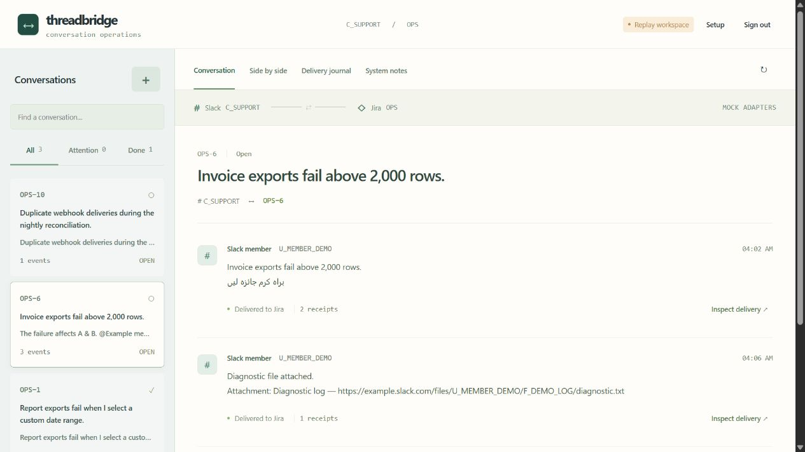
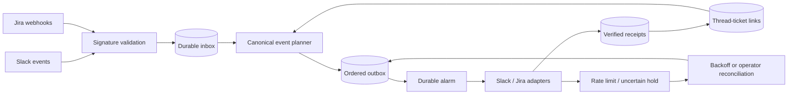

# Threadbridge

**[Try the guided walkthrough](https://zulfkicar.github.io/apps/threadbridge/)** · **[Explore the engineering](https://zulfkicar.github.io/apps/threadbridge/#engineering)**

The public walkthrough runs the production event parsers, planner, SQL journal and mock adapter in a Web Worker with SQLite WASM. Follow a request into Jira, reply in both directions, replay duplicates, send an echo, lose a delivery receipt, reconcile it and confirm a Done status. No accounts are needed. Source files and request evidence are inspectable. The browser database is in memory and clears on reload. Cloudflare persistence, alarms and signed ingress are checked separately in the local Worker runtime.

After changing core modules, run `npm run build:demo`. To copy the static walkthrough into the portfolio checkout, run `node scripts/build-demo.mjs ../github-site/apps/threadbridge`.

Slack conversations and Jira tickets, linked by a reliable Cloudflare Worker.

Create a Jira issue from a Slack thread or a Slack thread from a Jira issue. Mirror replies in both directions, reflect Jira status, and inspect every delivery. Bot echoes, duplicate events and stale status notifications are suppressed. Ambiguous writes are held for reconciliation instead of silently retried.

Jira is the first ticket adapter. The event planner, identity map and durable journal are independent of Jira HTTP calls.



## Try locally

Node 24.15+, no connected SaaS account needed for the simulator.

```sh
npm ci
cp .dev.vars.example .dev.vars
# Set ADMIN_TOKEN to a random URL-safe token of at least 24 characters.
npm run dev
```

Or, on Windows with WSL Docker:

```powershell
wsl docker compose -p threadbridge up --build -d
```

Open http://127.0.0.1:8875 and sign in with ADMIN_TOKEN. Create a Slack request, reply from Jira, change status, replay the event, then simulate a lost receipt and reconcile it using the mock provider evidence. The actual Worker and Durable Object execute this flow. Providers are mocked and no external message or ticket is created.

## What this demonstrates

- Raw-body Slack and Jira HMAC verification. Slack timestamp replay protection.
- Durable inbox acknowledgement before delivery, payload fingerprint conflict detection and root-level identity checks.
- SQLite-backed thread/ticket links and ordered effect outbox per bridge.
- Bidirectional comments, Jira ADF conversion, source metadata and service-actor loop prevention.
- Jira-owned status with stale-revision suppression. Slack reaction requests a transition and waits for Jira confirmation.
- Durable alarms, bounded rate-limit retries, held uncertain writes and verified-receipt recovery.
- A provider-neutral core and explicit Jira/Slack adapters.
- Original synthetic inputs, mock provider receipts and a console for inspecting failure scenarios.

## Architecture



More detailed Mermaid flow, sequence and recovery diagrams are in [architecture](docs/architecture.md).

## Connect real accounts

1. Configure a sandbox Slack team/channel, Jira project/issue type, Done transition ID and the Jira service account ID in wrangler.jsonc.
2. Set fresh Worker secrets using `wrangler secret put`: ADMIN_TOKEN, SLACK_SIGNING_SECRET, SLACK_BOT_TOKEN, JIRA_WEBHOOK_SECRET, JIRA_BASE_URL, JIRA_EMAIL and JIRA_API_TOKEN.
3. Subscribe Slack to channel/group messages and reaction_added. Use the appropriate channel event/history scopes and chat:write. Add the bot to the selected channel.
4. Register a signed Jira admin webhook for issue_created, issue_updated and comment_created, filtered to the configured project.
5. Use `/events/slack` and `/events/jira` as the receiver paths. Both validate signatures before parsing events. Jira delivery identifiers deduplicate webhook retries.
6. Switch MODE to live after sandbox checks. Live and mock state are separate. Deploy with your own Cloudflare account only when ready.

Actual Slack/Jira API compatibility, permissions and a production cutover are **not verified**. Mock receipts exercise our code and request contracts, not the providers' full behavior. OAuth installation, internal-comment visibility, files, message edits/deletes, multi-workspace routing and full production privacy/retention controls remain outside this release. Never point it at confidential production tickets without defining those policies.

The control console is token protected. Use HTTPS in a remote deployment and a long random token. Ticket text is stored in Durable Object SQLite. Keep account secrets outside Git. No company backup, real customer data or proprietary integration code is included.

## Check

```sh
npm test
npm run test:worker # actual local Workers runtime, mock providers
npm run types
npm run check
npm run build # local deployment dry run, no upload
```

Tests exercise normal round trips, early replies, duplicates, conflicting payloads, echoes, stale status, safe backoff, lost receipts, interrupted delivery, reaction semantics, request construction and signatures.

Development tooling includes a patched sharp override because the current Wrangler dependency tree otherwise reports a librsvg advisory. No image processing is used by this application. Run npm audit when updating dependencies.

Primary references: [Slack signatures](https://docs.slack.dev/authentication/verifying-requests-from-slack/), [Slack Events API](https://docs.slack.dev/apis/events-api/), [Jira webhooks](https://developer.atlassian.com/cloud/jira/platform/webhooks/), [Jira comments](https://developer.atlassian.com/cloud/jira/platform/rest/v3/api-group-issue-comments/), [Durable Object alarms](https://developers.cloudflare.com/durable-objects/api/alarms/).
## Latest interface and payload verification

The 2026-10-10 pass introduces a conversation queue, unified timeline, attention handling and a raw-payload replay drawer. It also fixes attachment-bearing replies, rich Jira text and timestamp normalization. See [latest verification](docs/verification-2026-10-10.md) and [fixture provenance](fixtures/README.md). These are native wire-format and export-derived contract tests, not claimed live account recordings.
