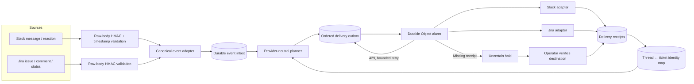
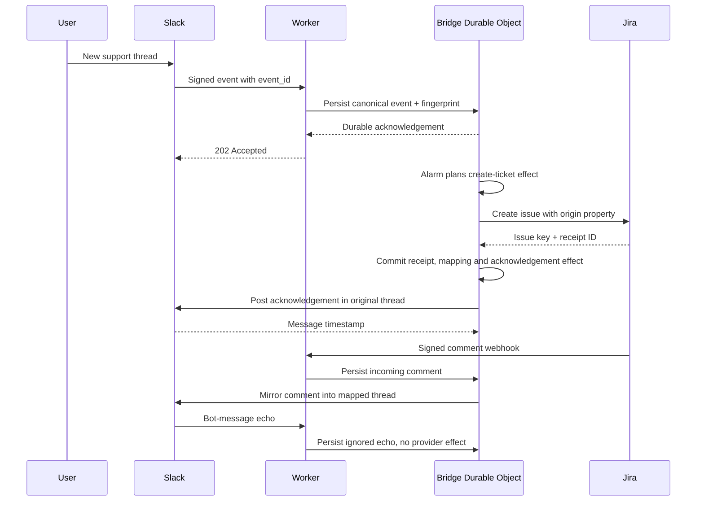
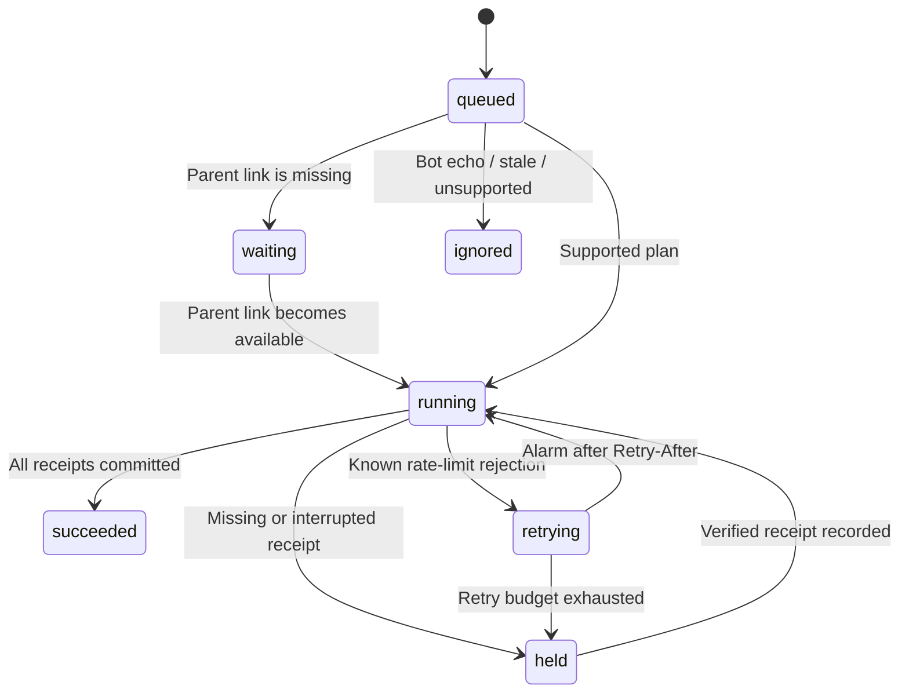

# Threadbridge architecture

The bridge keeps a conversation identity across Slack and a ticket system. Jira is the first provider adapter. The core is original code inspired by the integration patterns in the supplied exports, without company identifiers, custom API credentials, prompt contents or source code.

One SQLite-backed Durable Object owns each configured mode/workspace/channel/project bridge. Mock and live journals use different object names. No critical identity or delivery state lives only in memory. An instance-level promise serializes delivery while allowing ingress to persist new events. Durable storage supplies recovery after eviction.

Each journal also pins its configuration. Old alarms can wake objects after a Worker configuration change, so namespace separation alone is insufficient. A configuration mismatch pauses ingress and delivery, including old mock state after switching the Worker to live. Restore the original configuration or perform a reviewed migration before continuing that journal.

The inbox binds event ID to canonical-payload hash. Roots also check identity mappings at delivery time, which avoids duplicate ticket creation even when equivalent root events have different delivery IDs. Thread replies arriving early wait. Pending effects on a conversation wait behind uncertain or blocked predecessors. Other conversations continue. Alarm scheduling excludes these blocked tails, preventing a tight retry loop.

Jira owns ticket status. Slack reactions request configured transitions but do not claim completion. Only a Jira status event changes the recorded status. A revision check is repeated at delivery time to suppress stale status events prepared in the same batch.

No distributed transaction can atomically commit an API write and its local receipt. An unknown outcome is held for verification. Only known 429 responses are retried automatically, with a five-attempt budget. Unknown writes are never automatically repeated. There is currently no audited not-applied bypass for uncertain writes.

## Replaceable ticket provider

`BridgeEvent`, `Effect` and `Receipt` are the provider-neutral contract. A future Modal adapter implements the same create/comment/transition operations and a payload normalizer. Jira-specific ADF, REST URLs, webhook fields and origin properties stay in the provider adapter. Adding another adapter must include its own receipt and error semantics, not just substitute URLs.

## Boundaries

This prototype supports root creation in either direction, bidirectional comments and Jira status notifications, plus a configured root-message reaction requesting resolution. Attachments, message edits/deletes, internal-only comment policy, installation OAuth, multi-channel routing and reconciliation searches need separate contracts. The source exports include richer branch/attachment/formatting behavior. Those behaviors are not claimed as implemented here.

The mock provider keeps a distinct remote-receipt store. It can apply a write and then lose the response, demonstrating why the delivery journal must hold rather than retry. This is an operational simulator, not a live account demo.
